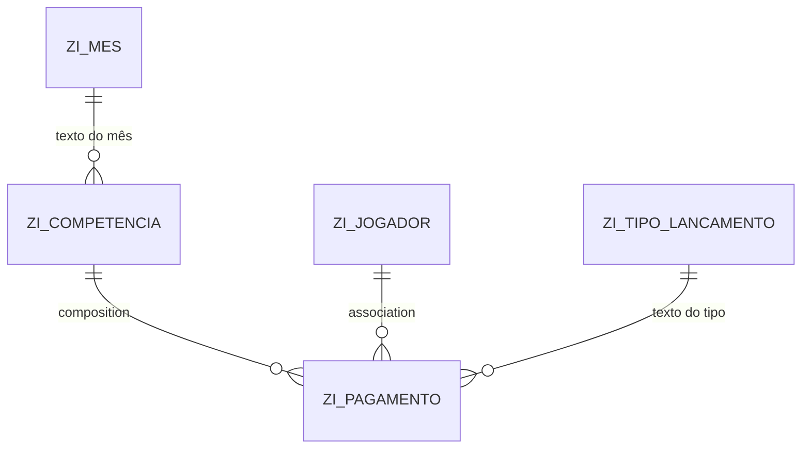

# ⚽ Gestão de Pagamentos de Jogadores (RAP + Fiori Elements)

Aplicação desenvolvida com **ABAP RESTful Application Programming Model (RAP)** para controlar os pagamentos mensais de jogadores de um grupo esportivo. O usuário cadastra jogadores, abre uma **competência** (mês/ano) e lança os pagamentos de cada jogador dentro dela, com acompanhamento do total arrecadado no período.

## 🖥️ Demonstração da aplicação
A aplicação utiliza SAP Fiori Elements, com interfaces baseadas em List Report e Object Page, proporcionando uma experiência integrada para o gerenciamento de jogadores, competências e pagamentos.

### 👥 Cadastro e Gerenciamento de Jogadores

Cadastro de jogadores com informações pessoais, contato, endereço e fotografia, incluindo validações implementadas na camada de comportamento RAP.

**Validações de dados**

Demonstração das validações de campos obrigatórios e consistência dos formatos de e-mail e telefone.

**Object Page do Jogador**

Visualização e manutenção dos dados cadastrais, com organização por grupos de informações e exibição da fotografia do jogador.

### 📅 Gestão de Competências

Visualização das competências cadastradas, com acompanhamento dos valores arrecadados em cada período.

### 💰 Detalhes da Competência e Pagamentos

Consulta dos dados da competência, acompanhamento do total arrecadado e gerenciamento dos pagamentos vinculados aos jogadores.

---

## 📌 Funcionalidades

- **Jogadores**: cadastro completo (dados pessoais, contato, endereço, foto) com validação de campos obrigatórios e de formato de e-mail e telefone.
- **Competências**: criação por mês/ano, com cálculo automático de data de início e fim e bloqueio de competências duplicadas.
- **Pagamentos**: lançados dentro da competência (relação pai/filho), com jogador, tipo de lançamento (PIX, Débito, Crédito, Dinheiro), valor e data.
- **Total da competência** exibido no cabeçalho, com **criticidade por faixa de valor** (semáforo).
- **Rascunho (draft)**: o usuário pode salvar o trabalho parcial e retomar depois.
- **Upload e exibição de foto** do jogador (JPEG/PNG).
- **Value helps** com texto no lugar do código (mês, tipo de lançamento, jogador).

---

## 🏗️ Arquitetura

| Camada | Objetos |
|---|---|
| **Tabelas** | `ZJOGADOR`, `ZCOMPETENCIA`, `ZPAGAMENTO` + tabelas de draft `ZJOGADOR_D`, `ZCOMPETENCIA_D`, `ZPAGAMENTO_D` |
| **Interface (CDS)** | `ZI_JOGADOR` (root), `ZI_COMPETENCIA` (root), `ZI_PAGAMENTO` (filho), `ZI_MES`, `ZI_TIPO_LANCAMENTO` |
| **Projeção (CDS)** | `ZC_JOGADOR`, `ZC_COMPETENCIA`, `ZC_PAGAMENTO` |
| **Metadata Extensions** | Anotações de UI para as três projeções |
| **Behavior Definitions** | BDEF de interface e de projeção para Jogador e Competência (com Pagamento como filho) |
| **Classes de comportamento** | `ZBP_I_JOGADOR`, `ZBP_I_COMPETENCIA` |
| **Mensagens** | `ZCM_JOGADOR`, `ZCM_COMPETENCIA`, `ZCM_PAGAMENTO` |
| **Serviço** | Service Definition: ZUI_JOGADOR + Service Binding: ZUI_JOGADOR_O4 |

### Modelo de dados

- **Jogador** é um objeto de negócio independente (root).
- **Competência** é root e tem uma **composition** com **Pagamento**: não existe pagamento sem competência.
- **Pagamento** referencia o jogador por **association**.

---

## 🧰 Conceitos de RAP aplicados

- Modelo **managed** com **draft** e `strict ( 2 )`
- **EML (Entity Manipulation Language)** operações de leitura e modificação das entidades RAP.
- **Early numbering** com UUID (`cl_system_uuid`)
- **Composition** pai/filho com `lock dependent` e `authorization dependent`
- **Determinations** (`on modify` e `on save`) para valores padrão, datas e data de criação
- **Validations** com `%state_area` para limpar mensagens antigas no draft
- **Draft determine action Prepare** executando as validations antes da ativação
- **Total ETag** com `LastChangedAt`
- **Projeção transacional** com `redirected to parent` / `composition child`
- **Mensagens** via classe de mensagens (`new_message`)
- **Anotações de UI**: `headerInfo`, `facet`, `fieldGroup`, `lineItem`, `identification`, `selectionField`, `dataPoint`, `presentationVariant`
- **Criticidade** dinâmica em colunas e data point
- **Value help** (`@Consumption.valueHelpDefinition`) e **text arrangement** (`@ObjectModel.text.element`)
- **Large objects** (`@Semantics.largeObject`) para imagem

---

## ✅ Regras de negócio

| Regra | Onde |
|---|---|
| Nome, telefone e e-mail do jogador são obrigatórios | `validarDadosObrigatorio` |
| E-mail deve conter `@`; telefone deve ter 10 ou 11 dígitos | `validarFormatoEmailTelefone` |
| Não pode existir mais de uma competência para o mesmo mês/ano | `validarDuplicidade` |
| Ano da competência é obrigatório | `validarAno` |
| Jogador e data de lançamento são obrigatórios no pagamento | `dadosObrigatorios` |
| Data de início e fim são calculadas a partir de mês/ano | `calcularDatas` |
| Mês e ano iniciam com a data atual ao criar | `setDefaultsCompetencia` |
| Data de cadastro e status "ativo" iniciam preenchidos no jogador | `setDefaults` |

### Criticidade do total

| Faixa de total (R$) | Cor |
|---|---|
| 0 a 350 | 🔴 Vermelho |
| 351 a 699 | 🟠 Laranja |
| 700 ou mais | 🟢 Verde |

---

## 🚀 Como instalar

### Pré-requisitos

- SAP S/4HANA 2023 FPS01 (ABAP Platform 2023).
- Suporte ao ABAP Cloud e ao modelo RAP.
- ABAP Development Tools (ADT) instalado no Eclipse.
- abapGit instalado no sistema SAP (zabapgit_standalone).
- SAP Fiori Elements com suporte a OData V4.

> **Observação:** O projeto foi desenvolvido e testado em SAP S/4HANA
> 2023 FPS01. A importação em outros releases pode exigir ajustes
> de compatibilidade e ativação dos objetos.

### Passos

1. Crie um pacote (ex.: `ZPAGAMENTOS`).
2. No abapGit, crie um repositório online apontando para este projeto e faça o **Pull**.
3. Ative todos os objetos (`Ctrl + Shift + F3` no ADT).
4. Abra o **Service Binding** e clique em **Publish**.
5. Use **Preview** na entidade `Competencia` ou `Jogador` para abrir o app.

> Se algum objeto ficar inativo, ative na ordem: tabelas → views de interface → views de projeção → BDEFs → classes → metadata extensions → service.

---

## 🖥️ Como usar

1. Abra **Jogadores** e cadastre os participantes.
2. Abra **Competências** e crie uma nova (mês e ano já vêm sugeridos).
3. Na Object Page, adicione os **pagamentos** na tabela *Lista de Pagamentos*.
4. Acompanhe o **Valor Total** no cabeçalho.
5. Clique em **Salvar** para ativar o rascunho.

---

## 🧠 Decisões técnicas

- **Draft habilitado**: permite preencher o cadastro em mais de uma sessão sem perder dados.
- **UUID com early numbering**: evita colisões e permite referenciar o registro antes de salvar, requisito para composition com draft.
- **View de texto sem tabela** (`ZI_MES`, `ZI_TIPO_LANCAMENTO`): domínios pequenos e fixos modelados por `union` em CDS, sem tabela de customizing.

---

## 🔭 Próximos passos

- [ ] Testes ABAP Unit para as validations
- [ ] Controle de autorização por perfil
- [ ] Relatório de inadimplência por competência
- [ ] Exportação para Excel

---

## 🛠️ Tecnologias

`ABAP Cloud` · `RAP` · `CDS View Entities` · `OData V4` · `Fiori Elements` · `abapGit`

---

## 👤 Autor

**Wellington Xavier**

Desenvolvedor SAP ABAP | SAP RAP | SAP Fiori

[LinkedIn](www.linkedin.com/in/wellington-xavier-dos-santos) ·
[GitHub](https://github.com/WellingtonXavi)

---

